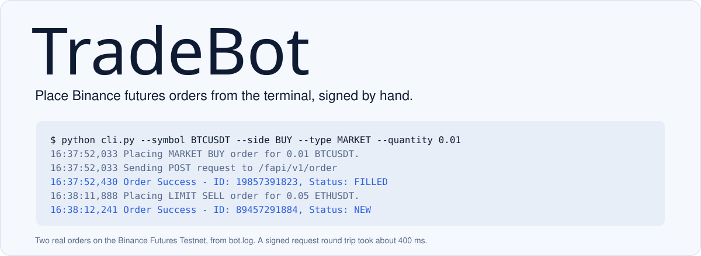

<picture>
  <source media="(prefers-color-scheme: dark)" srcset="docs/readme/banner-dark.svg">
  
</picture>

TradeBot places market and limit orders on the Binance USDT-M Futures Testnet from the command line. I wrote the request signing myself instead of pulling in `python-binance`, which meant learning how Binance's HMAC-SHA256 signatures actually work.

## Run it

You need a Testnet API key from [testnet.binancefuture.com](https://testnet.binancefuture.com/). Testnet money isn't real, so nothing here can lose any.

```bash
python -m venv venv
venv\Scripts\activate            # macOS/Linux: source venv/bin/activate
pip install -r requirements.txt
```

Put your keys in a `.env` file next to `cli.py` (it's git-ignored):

```env
BINANCE_TESTNET_API_KEY=...
BINANCE_TESTNET_API_SECRET=...
```

Then place an order:

```bash
python cli.py --symbol BTCUSDT --side BUY --type MARKET --quantity 0.01
python cli.py --symbol ETHUSDT --side SELL --type LIMIT --quantity 0.05 --price 2000
```

Leave a flag out and it asks for it. Pick LIMIT without a price, and it asks for the price instead of failing.

## How it works

| File | Job |
|---|---|
| `cli.py` | The Click command: prompts, prints a summary, reports the result |
| `bot/validators.py` | Rejects bad symbols, sides, types, quantities and missing limit prices before any request is sent |
| `bot/client.py` | Adds a timestamp, signs the query string with HMAC-SHA256, and sends it with the API key header |
| `bot/orders.py` | Builds the `/fapi/v1/order` payload, adding `price` and `timeInForce=GTC` for limit orders |
| `bot/logging_config.py` | Logs every request and response to `bot.log` |

Errors are kept apart on purpose. A typo gets a validation message, while a rejected or failed request is logged in full and gets a short message in the terminal.
